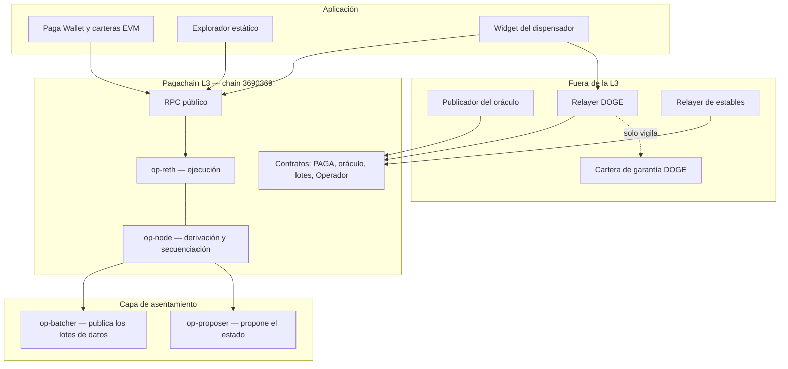
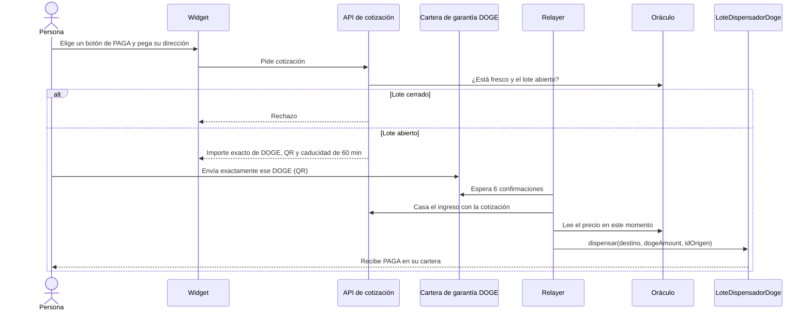
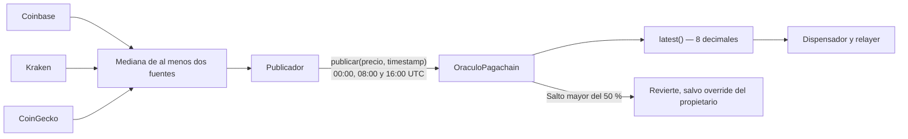
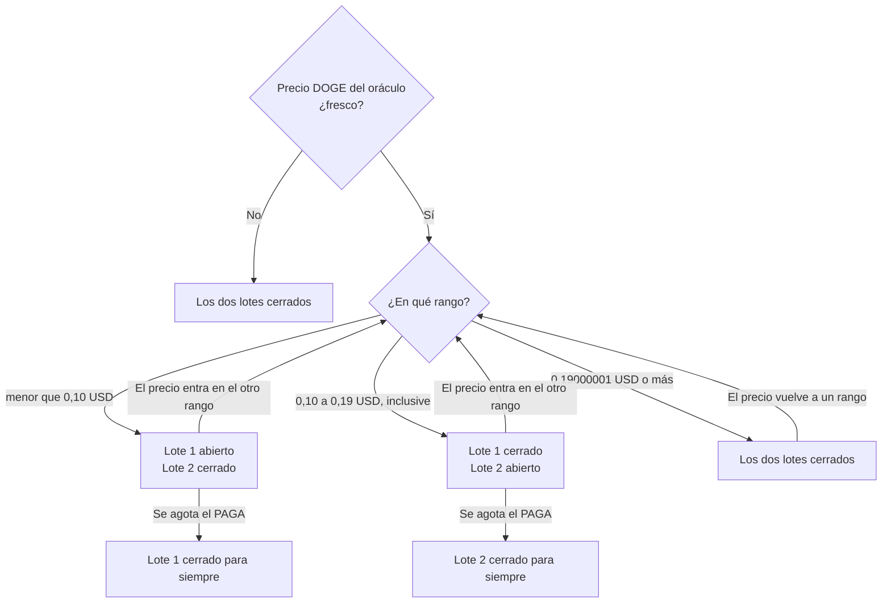

# Pagachain v1 (versión inicial)

Documentación técnica y biblioteca de contratos de la primera versión de Pagachain. Sirve para mostrarla a un cliente que quiera ideas —o piezas ya escritas— para construir su propia L3.

Este directorio está listo para convertirse en un repositorio. No incluye claves, ni scripts de envío, ni datos de servidores.

**Pagos Labs.** Jesús (CEO), Carlos (COO), Santi (CTO).

Eslogan de la marca, única frase en inglés: *We Build Private Blockchain Infrastructure.*

Pagos Labs no es un banco ni pretende serlo.

**Aviso:** Billeteras de autocustodia: úsalas bajo tu propio riesgo. Lee las reglas antes de intercambiar.

---

## Qué es Pagachain

Pagachain es una cadena L3 compatible con EVM (OP Stack).

| | |
|---|---|
| Nombre | Pagachain |
| Chain ID | `3690369` (`0x384f81`) |
| RPC | `https://pagachain.com` |
| Explorador | `https://explorer.pagachain.com` |
| Gas nativo | CENT (18 decimales) |
| Token de aplicación | PAGA (ERC-20, 6 decimales) |
| Dirección de PAGA | `0xbfE1D53cb99f5873E3d62EfaAc4F7d0cC2f94b9A` |
| Suministro de PAGA | `1.873.474.920` (emisión única, 8 nov 2026) |
| Oráculo DOGE/USD | `0xc4E8c11dCe3D664AA8Aef6b14E0CA2910e3B3Dc4` |
| Wrapped Cent | `0x4200000000000000000000000000000000000006` |

PAGA se acuñó entero al desplegar, sin facultad de emitir más, sin propietario y sin pausa. La cifra sale de `2.628.000.000` DOGE × `0,071289` USD / `0,10` USD (precio del 8 nov 2026, 16:22, Europe/London).

El lote 1 del dispensador DOGE→PAGA está en uso desde el 17 nov 2026: `3.690.369` PAGA a un precio fijo de `0,10` USD, abierto solo mientras el oráculo marca el DOGE por debajo de `0,10` USD. El lote 2 (mismo precio fijo, abierto entre `0,10` y `0,19`) está escrito y probado en local, todavía sin desplegar.

## Contenido de este paquete

| Documento | Contenido |
|---|---|
| [WHITEPAPER.md](WHITEPAPER.md) | Versión larga: contexto, reglas, estado de cada pieza y límites |
| [docs/biblioteca-de-contratos.md](docs/biblioteca-de-contratos.md) | Todos los contratos de lotes, operador, oráculo, bloqueo y relayers, con su caso de uso |
| [docs/auditoria-y-seguridad.md](docs/auditoria-y-seguridad.md) | Principios de seguridad y resumen de la revisión externa del 15 nov 2026 |
| [docs/como-construir-tu-l3.md](docs/como-construir-tu-l3.md) | Guion para montar una L3 propia reutilizando estas piezas |
| [contracts/](contracts/README.md) | Fuentes públicos (sin scripts de despliegue) |

---

## Arquitectura

### Pila de la cadena

### Flujo del dispensador DOGE → PAGA

### Flujo del oráculo

### Apertura y cierre de los lotes del dispensador

El PAGA, en ambos lotes, está fijo a `0,10` USD. Lo que cambia es el rango en el que el lote acepta el intercambio. En `0,10` USD exacto no hay solape ni hueco: cierra el 1 y abre el 2.

---

## Piezas principales

- **Explorador:** página estática (versión `1.0.1`). Muestra bloques, transacciones, saldos CENT y PAGA, y transferencias ERC-20. El widget del lote 1 vive en el pie, no en la web de Pagos Labs.
- **Cartera:** Paga Wallet, de autocustodia, para Android, iOS y PWA. Habla con el RPC y, si hace falta gas para enviar PAGA, con un servicio de recarga de CENT. Las claves no salen del dispositivo.
- **Operador y lotes calendarios:** desplegados el 12 nov 2026. Precio `0,10` USD los dos primeros años o hasta agotar el lote de adopción; después `0,20` para siempre. El inventario de `1.686.127.428` PAGA **no se ha fondeado**. Solo hay `500` PAGA de prueba en el lote del Operador.
- **Relayer de estables (USDT en Tron):** escrito y probado en local, con el envío automático apagado, a la espera de autorización.

La lista completa, con direcciones y casos de uso, está en la [biblioteca de contratos](docs/biblioteca-de-contratos.md).

## Seguridad, en breve

El 15 nov 2026 una revisión externa de los contratos del Operador y de los lotes concluyó: no fondear todavía; tras corregir críticos y altos, «sí con cambios». Se respetó ese criterio: no se transfirió el inventario principal. Después se escribió un rediseño v2, solo local, con 78 pruebas, que no sustituye a lo ya desplegado. El detalle está en [docs/auditoria-y-seguridad.md](docs/auditoria-y-seguridad.md).

## Lecciones que nos dejamos escritas

- Las reglas públicas (precio, rango, cantidad, fecha) conviene dejarlas en el contrato desde el primer día, cuando todavía nadie discute el proyecto.
- Un lote sin función de retirada es más simple de explicar y de revisar que un inventario que el administrador puede sacar.
- Un oráculo viejo debe cerrar el intercambio, no dejarlo abierto con un dato caducado.
- El pago que llega de otra cadena se identifica mejor con un importe etiquetado o un intento previo, no con una dirección de depósito por cliente.
- Hay que esperar confirmaciones y usar un `idOrigen` de un solo uso.
- Una revisión externa sirve de poco si se fondea antes de atender lo crítico.
- El RPC y los registros (`eth_getLogs`) tienen límites reales; hay que paginar.
- Probar en local con un oráculo de prueba permite recorrer los límites de precio sin fondos reales.
- En el lenguaje público se dice *intercambiar*, no otra cosa, y se deja claro que no somos un banco.

## Cómo construir tu propia L3

El guion paso a paso está en [docs/como-construir-tu-l3.md](docs/como-construir-tu-l3.md): acordar reglas, levantar la pila OP Stack, publicar RPC y explorador, desplegar token y oráculo, elegir módulos de la biblioteca, montar relayers, cuidar la cartera y el gas, y solo al final fondear.

## Licencia

MIT. Véase [LICENSE](LICENSE).
