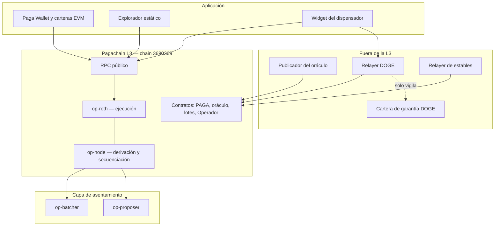
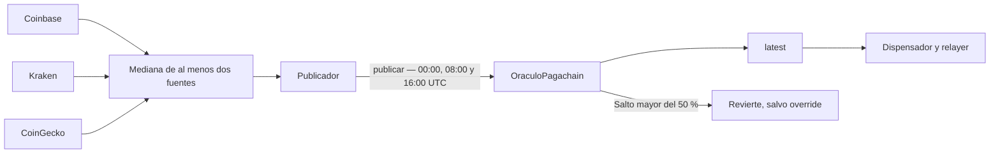
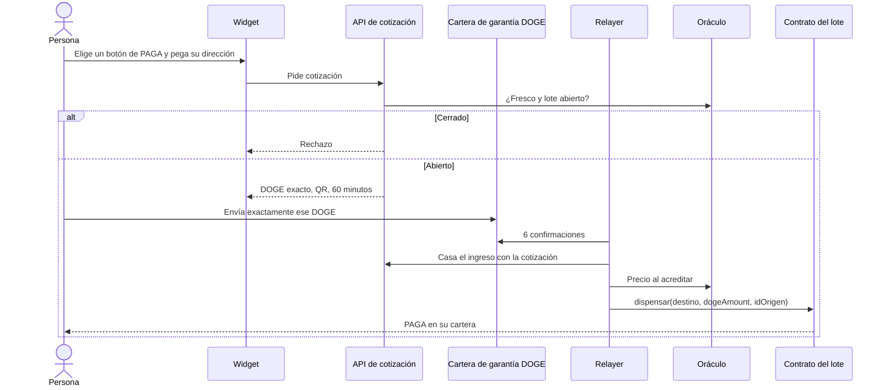
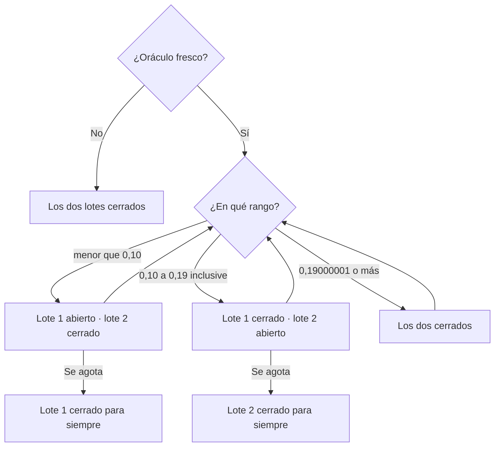

# Pagachain v1 — documento técnico

Versión inicial, noviembre de 2026. Este texto describe lo que se llegó a construir, lo que se desplegó, lo que se revisó y lo que se dejó listo en local. Está pensado para un lector que quiera entender el sistema o reutilizarlo al construir su propia L3.

Los números que aparecen salen de los contratos y de las notas de este paquete. Si un dato no estaba en esas fuentes, no se ha inventado.

**Pagos Labs.** Jesús (CEO), Carlos (COO), Santi (CTO).

*We Build Private Blockchain Infrastructure.*

Pagos Labs no es un banco ni pretende serlo. Un precio de referencia no es un derecho de rescate. Las garantías que se mencionan son reglas públicas de un contrato y saldos visibles, no una promesa de reembolso.

**Aviso:** Billeteras de autocustodia: úsalas bajo tu propio riesgo. Lee las reglas antes de intercambiar.

---

## 1. Resumen

Pagachain es una cadena L3 compatible con EVM, construida con OP Stack, con identificador `3690369`. El gas nativo es CENT. El token de aplicación es PAGA: un ERC-20 de 6 decimales y suministro fijo `1.873.474.920`, acuñado una sola vez el 8 de noviembre de 2026.

Junto a la cadena hay un oráculo DOGE/USD, un explorador estático, una cartera de autocustodia, un operador de acreditaciones para pagos que llegan desde otras redes, un calendario de lotes a varios años y un dispensador automático que intercambia PAGA por DOGE nativo según un precio fijo y un rango público.

La pieza que ya está en uso de punta a punta es el **lote 1 del dispensador**. Una persona elige en el widget cuántos PAGA quiere recibir, paga el DOGE exacto que se le cotiza (por QR) a una cartera de garantía pública y, tras 6 confirmaciones, un relayer llama al contrato y le llegan los PAGA. El lote solo está abierto mientras el oráculo marca el DOGE por debajo de `0,10` USD.

El resto del diseño de lotes —calendario 2026–2030, operador, fundadoras, rediseño v2 posterior a la revisión externa, y el lote 2 del dispensador— queda documentado y, cuando hay código, incluido en `contracts/`, para no perder ese trabajo. Un cliente puede tomar una pieza y reutilizarla. Véase [docs/biblioteca-de-contratos.md](docs/biblioteca-de-contratos.md).

## 2. La cadena

### 2.1 Parámetros públicos

| Parámetro | Valor |
|---|---|
| Nombre | Pagachain |
| Tipo | L3 EVM, OP Stack |
| Chain ID | `3690369` (`0x384f81`) |
| RPC | `https://pagachain.com` |
| Explorador | `https://explorer.pagachain.com` |
| Gas nativo | CENT, 18 decimales, símbolo `₵` en la cartera |
| Token | PAGA, nombre «Paga», 6 decimales |
| PAGA | `0xbfE1D53cb99f5873E3d62EfaAc4F7d0cC2f94b9A` |
| WCENT | `0x4200000000000000000000000000000000000006` |
| Predespliegue `L1Block` | `0x4200000000000000000000000000000000000015` |

El cliente de ejecución de esta v1 es `op-reth`. El explorador pagina `eth_getLogs` en tramos de **100.000 bloques**, que es el límite de ese cliente. Los clientes HTTP envían un `User-Agent`. El RPC publica `Access-Control-Allow-Origin: *`, de modo que el navegador puede llamarlo en directo; nginx ofrece además un proxy en `/rpc`.

### 2.2 Pila

La pila sigue el modelo habitual de OP Stack:

1. `op-reth` ejecuta los bloques y sirve el RPC.
2. `op-node` deriva el estado y secuencia.
3. `op-batcher` publica los datos en la capa de asentamiento. Si esa capa no tiene blobs, se usa calldata.
4. `op-proposer` publica las propuestas de estado.

El gas del batcher y del proposer se paga en la capa de asentamiento y no debe mezclarse con el inventario de PAGA. El usuario de la aplicación no tiene por qué ver esa capa: habla con el RPC, el explorador y, si acaso, un servicio de recarga de CENT.



### 2.3 Explorador y cartera

**Pagachain Explorer** (versión `1.0.1`) es una página estática, sin base de datos propia. Muestra bloques y transacciones (oculta por defecto las de sistema), búsqueda por hash, número o dirección, y rutas EIP-3091. En una dirección se ven el saldo nativo, el saldo PAGA y, si hay, WCENT. El widget del dispensador se coloca solo en el pie de este explorador, no en la web de Pagos Labs.

**Paga Wallet** es una cartera de autocustodia para Android, iOS y PWA. Crea o importa la frase en el dispositivo, la cifra (PBKDF2 y AES-GCM) y no la envía a ningún servidor. La derivación es `m/44'/60'/0'/0/0`. El idioma por defecto es el español. La app se niega a firmar si el RPC no reporta el chain id `3690369`. Si un envío de PAGA no tiene gas, puede pedir una recarga pequeña de CENT a un servicio que solo recibe la dirección y el chain id, nunca una frase ni una clave. Ese servicio, en el diseño de esta v1, solo recarga direcciones que ya tienen al menos una unidad de PAGA, con topes por dirección, por IP y por día.

Cualquier otra cartera EVM puede añadir la red con los datos de la tabla anterior.

## 3. El token PAGA

Contrato `contracts/paga/Paga.sol`. Compilado en Remix, Solidity `0.8.34`, EVM cancun.

- Emisión única en el constructor, al desplegador.
- Sin mint posterior, sin propietario, sin pausa, sin confiscación.
- Rechaza la dirección cero.
- `totalSupply` es una constante: `1.873.474.920 * 10^6`.

La base de cálculo quedó anotada en el propio fuente: `2.628.000.000` DOGE × `0,071289` USD / `0,10` USD, el 8 nov 2026 a las 16:22 (Europe/London). El precio de DOGE solo sirvió para fijar la oferta **antes** de desplegar; no hay mint dinámico.

De ese suministro, el 90 % (`1.686.127.428` PAGA) quedó asignado a cinco lotes calendarios. El 10 % restante (`187.347.492` PAGA) se reservó fuera de esos cinco lotes (promoción, gas y un lote de prueba de 500 PAGA). El dispensador DOGE usa un lote **aparte** de `3.690.369` PAGA, que no sale del lote de adopción ni de `Operador.acreditar`.

## 4. El oráculo

Contrato `OraculoPagachain` en `0xc4E8c11dCe3D664AA8Aef6b14E0CA2910e3B3Dc4`. Precio DOGE/USD con 8 decimales, en el mismo formato que un feed típico tipo AggregatorV3.

El propietario fija un publicador. El publicador llama a `publicar(precio, timestamp)` al menos tres veces al día (00:00, 08:00 y 16:00 UTC). Consulta Coinbase, Kraken y CoinGecko y toma la **mediana** de al menos dos fuentes. Un cambio de más del 50 % respecto al último precio revierte, salvo que el propietario use `publicarConOverride`.

La lectura es `latest()` y `latestRoundData()`. El dispensador considera el dato válido si está fresco. En el contrato del lote 1 la edad máxima es `93.600` segundos (26 horas). El relayer aplica un criterio más estricto: 9 horas, porque el oráculo publica cada 8. Si la marca de tiempo va un poco por delante del bloque, hay una holgura de 5 minutos. Si el dato es viejo, vacío o caído, el lote se trata como cerrado.



## 5. El dispensador DOGE → PAGA

Esta es la pieza automática de la v1 que ya opera con inventario real. La idea es sencilla: un lote cerrado de PAGA, con reglas fijas y públicas, se intercambia por DOGE nativo. El DOGE se queda en una cartera de garantía pública. El PAGA, una vez dentro del contrato, no se puede retirar. Si el precio sale del rango, el lote se cierra solo; si vuelve, se reabre, hasta que se agota.

Fórmula, con PAGA fijo a `0,10` USD:

```
PAGA = DOGE × precioDOGE / 0,10
```

Se trunca hacia abajo, a 6 decimales. Ejemplo del lote 1: `1.000` DOGE a `0,057` USD → `570` PAGA. En el lote 2, a `0,15` USD, `1.000` DOGE → `1.500` PAGA; a `0,19` USD, `1.900` PAGA.

### 5.1 Lote 1 (en uso desde el 17 nov 2026)

| | |
|---|---|
| Contrato | `0xc0be31904869A9d2cF147B16C9A60C36b4896f6f` |
| Tamaño | `3.690.369` PAGA, sin recarga y sin retirada |
| Abierto cuando | oráculo fresco y DOGE **menor que** `0,10` USD |
| Relayer | `0x6EDb9882E502DC75c67eb6752148e6a0282dF3E4` |
| Administración (constructor) | `0xF34F8d4eF363858cA5979eA41DF1b3580bb765ED` |
| Cartera de garantía | `DKZayo26HFgFhttAWQSqMUBxmNLQR7irJd` |

El administrador solo puede cambiar el relayer y pausar o reanudar. No saca PAGA. `idOrigen` es `keccak256` del txid de Dogecoin y no se puede repetir. La transacción fundadora de la cartera de garantía (13 nov 2026, `369,0369` DOGE, txid `340489ba34a3d4295bb7b5c5f794d5421fe8f904a50868c11f9b3d8f4cf818dd`) se ignora.

El widget vive en el pie del explorador. Los botones son cantidades de PAGA que recibe la persona: `10`, `30`, `50`, `100`, `300`, `600`, `3.000`, `10.000`. El widget muestra el DOGE exacto a pagar y un QR. No hay que teclear el importe. La cotización lleva una etiqueta de 4 decimales y caduca a los 60 minutos. Un solo recuadro «⚠️ Aviso» cubre tres casos: enviar otra cantidad, enviar desde un exchange (descuentan comisión) o tardar más de 60 minutos. Cabecera: *«Cuando 1 PAGA vale más que 1 DOGE, fortalece nuestras garantías intercambiando aquí.»*

El 17 nov 2026 se hicieron dos intercambios reales de comprobación. Tras 6 confirmaciones de Dogecoin, el contrato acreditó exactamente lo cotizado (unos 15 minutos de punta a punta; la mayor parte de la espera es de la red Dogecoin).

### 5.2 Lote 2 (escrito, no desplegado)

Misma fórmula y mismo tamaño previsto (`3.690.369` PAGA), con el rango parametrizado en el constructor. Abierto cuando el DOGE está entre `0,10` y `0,19` USD, ambos inclusive (`10_000_000 <= precio <= 19_000_000`). En `0,19000001` o más, se cierra. Si el precio vuelve al rango, se reabre.

Los dos lotes no se solapan y no dejan hueco: en `0,10` exacto cierra el 1 y abre el 2. Nunca están abiertos a la vez. Hay 21 pruebas locales que recorren esos bordes, la reapertura, el oráculo viejo, la pausa, la repetición de `idOrigen` y la imposibilidad de que el administrador saque PAGA.

El widget, todavía sin publicar, usa este texto: *«Aprovecha: obtén PAGA con descuento intercambiando aquí.»* La frase «intercambiando aquí» es el botón. Su API tiene que ser distinta de la del lote 1, y el relayer debe acreditar en el contrato de la cotización original, no en el que esté abierto «ahora».

### 5.3 Flujo





No se crean direcciones de depósito por cliente: basta el importe exacto, los botones y el QR. Si no hay cotización, hay varias, o el lote se cerró entre la cotización y el casado, el DOGE se queda en la garantía y el caso pasa a revisión. No se acredita a ciegas en otro lote.

## 6. Operador y lotes calendarios

Desplegados el 12 nov 2026. Compilador de referencia: Solidity `0.8.24`, EVM cancun, optimizador 200 runs.

| Contrato | Dirección |
|---|---|
| Lote del Operador | `0xbA525fa741cd8B1fa359Ba48D251AA729423bF87` |
| Lote complementario | `0x39dfF4bb8128A9b5f24BF3c1F7A6CE61Edd6cCDd` |
| Operador | `0x31b6E4FC99a0A150DeA1E8f583A1A9b9b6b5aCe6` |
| PagaLotes | `0xe648A95248397C3c5Fc025C33C14214D5Fe110c0` |
| Administración / tesorería (constructor) | `0xF34F8d4eF363858cA5979eA41DF1b3580bb765ED` |

`PagaLote` es un lote bloqueado reutilizable: se fondea enviando PAGA a su dirección y solo entrega el contrato autorizado. El administrador no puede retirar el inventario.

`PagaLotes` custodia, cuando se fondee, `1.686.127.428` PAGA en cinco tramos inmutables, todos con destino el lote del Operador:

| Lote | Fecha (00:00 UTC) | Cantidad |
|---|---|---:|
| 0, adopción | 6 dic 2026 | 281.021.238 |
| 1 | 6 dic 2027 | 281.021.238 |
| 2 | 6 dic 2028 | 374.694.984 |
| 3 | 6 dic 2029 | 374.694.984 |
| 4 | 6 dic 2030 | 374.694.984 |

El lote 0 se abre por fecha. Un lote siguiente solo se abre si al destino le queda menos de 1 PAGA; si no, reintento a 300 días. `liberar` puede llamarla cualquiera. «Automático», en una EVM, significa que alguien tiene que enviar esa transacción cuando las condiciones ya se cumplen.

El `Operador` acredita PAGA cuando un relayer informa de un pago recibido fuera de Pagachain. Precio: `0,10` USD durante dos años desde el instante del despliegue, o hasta agotar el lote de adopción de `281.021.238` (lo que ocurra antes); después, `0,20` USD para siempre. Mínimo `1,00` USD. A los 6 años se deja de acreditar. El remanente se puede bloquear (en `PagaBloqueoPermanente`) o quemar; los dos caminos están en el código y la elección quedó abierta. Las primeras 369 carteras distintas, a partir de 1 USD, se registran como fundadoras.

En esta versión, el contrato emite `ConversionPendiente` por el 70 % de un pago en estables (la conversión a DOGE ocurre fuera de la L3) y deja un 30 % como reserva operativa. Si el pago ya es DOGE, no se emite conversión.

**Estado del inventario:** solo se fondearon `500` PAGA de prueba en el lote del Operador. El lote complementario está a cero. No se ha transferido `1.686.127.428` PAGA, no se ha llamado a `liberar` y no se ha fondeado el complementario.

El relayer de USDT en Tron (v1) está escrito y probado en local. Por defecto solo prepara los valores de `acreditar`. Espera la solidificación y 20 bloques, casa un intento previo, usa `idOrigen = keccak256(abi.encode("tron", "USDT", txid))` y rechaza importes menores de 1 USDT o mayores de 100 USDT. El envío automático y el cambio on-chain del relayer quedaron pendientes de autorización.

## 7. El rediseño v2

El 15 nov 2026 una revisión externa de los contratos del Operador y de los lotes pidió no fondear todavía. Ese criterio se respetó. A continuación se escribió un rediseño, solo local, en `contracts/v2/`, con 78 pruebas. No sustituye ni toca lo ya desplegado.

Ese árbol cierra varios de los puntos de la revisión: ventanas de tiempo, contabilidad interna, tope por cartera para fundadoras, demora de 48 h al proponer un relayer nuevo (la revocación es inmediata), pausa limitada, bloqueo permanente como destino, y una lista cerrada de poderes del administrador. Incluye un lote de implementación (`674.450.971` PAGA, días 730–1030, con una reserva de `147.600.000` para fundadoras), un lote final (`303.502.937` PAGA, días 2000–2300) y un dispensador con faucet (`1.000.000` PAGA) y una partida para bots (`707.173.520` PAGA) acreditada cuando el relayer informa de PLS recibido fuera de Pagachain.

Si un cliente puede partir de cero, este árbol es la base más conservadora. El detalle está en la biblioteca y en [docs/auditoria-y-seguridad.md](docs/auditoria-y-seguridad.md).

## 8. Seguridad y lecciones

La revisión del 15 nov 2026 no encontró overflow ni reentrada en lo que examinó, y confirmó las cifras de los tramos y las fechas. Señaló, entre otros puntos, que decidir la apertura de un lote por el saldo real permite bloquearlo con una donación pequeña; que el relayer de esa versión no tenía topes ni demora al cambiarlo; que `fijarAutorizado` se podía cambiar siempre; que la pausa no tenía límite; y que faltaba revisar también el token, el relayer y el procedimiento de despliegue.

Lecciones que nos dejamos escritas:

1. Fijar las reglas en el contrato desde el primer día, cuando todavía nadie discute el proyecto.
2. Un lote sin retirada administrativa es más simple de explicar y de revisar.
3. Un oráculo viejo cierra el intercambio.
4. Una sola dirección de cobro y un importe etiquetado bastan; no hace falta una dirección por cliente.
5. Confirmaciones e `idOrigen` de un solo uso, siempre.
6. No fondear un inventario grande si la revisión todavía pide cambios de peso.
7. Contar con los límites reales del RPC y de `eth_getLogs`.
8. Probar los bordes de precio en local, con un oráculo de prueba, antes de usar fondos reales.
9. En el texto público se dice *intercambiar*, y se deja claro que no somos un banco.

Esta documentación no reemplaza una auditoría del árbol que un cliente vaya a desplegar.

## 9. Cómo reutilizar este trabajo

El guion está en [docs/como-construir-tu-l3.md](docs/como-construir-tu-l3.md). En resumen: acordar las reglas, levantar la pila OP Stack, publicar RPC y explorador, desplegar el token y el oráculo, elegir módulos de la [biblioteca](docs/biblioteca-de-contratos.md), montar relayers en modo seco, cuidar la cartera y el gas del usuario, y solo al final fondear.

Una guía rápida:

- Token fijo → `Paga`
- Precio público → `OraculoPagachain`
- Lote que abre y cierra solo, según un rango → `LoteDispensadorDoge`
- Calendario a varios años → `PagaLotes` + `PagaLote`
- Pago que llega desde otra cadena → `Operador` o, si se parte de cero, `PagaOperador` (v2)
- Sacar inventario de circulación → `PagaBloqueoPermanente`

## 10. Qué no entra en esta v1

- No hay, en este paquete, un contrato de los megalotes posteriores que se llegaron a comentar (un lote eterno por DOGE, otro por PLS y otro por estables, más una partida de adopción). Esa simplificación, si se hace, será un trabajo distinto.
- No se documentan aquí estudios económicos anteriores que usaban otras cifras de suministro o reglas de cobertura que quedaron abiertas o en conflicto. El suministro que cuenta es el que está en cadena: `1.873.474.920` PAGA.
- No se incluyen claves, archivos de entorno, direcciones de servidores ni indicaciones de quién guarda cada clave.
- Paga Wallet no se distribuye en este paquete.

## 11. Direcciones de referencia (Pagachain, 3690369)

```
PAGA                 0xbfE1D53cb99f5873E3d62EfaAc4F7d0cC2f94b9A
Oráculo DOGE/USD     0xc4E8c11dCe3D664AA8Aef6b14E0CA2910e3B3Dc4
Dispensador lote 1   0xc0be31904869A9d2cF147B16C9A60C36b4896f6f
Relayer del lote 1   0x6EDb9882E502DC75c67eb6752148e6a0282dF3E4
Lote del Operador    0xbA525fa741cd8B1fa359Ba48D251AA729423bF87
Lote complementario  0x39dfF4bb8128A9b5f24BF3c1F7A6CE61Edd6cCDd
Operador             0x31b6E4FC99a0A150DeA1E8f583A1A9b9b6b5aCe6
PagaLotes            0xe648A95248397C3c5Fc025C33C14214D5Fe110c0
WCENT                0x4200000000000000000000000000000000000006
RPC                  https://pagachain.com
Explorador           https://explorer.pagachain.com
Garantía DOGE        DKZayo26HFgFhttAWQSqMUBxmNLQR7irJd
```

Cada valor, en su bloque, para copiar:

```
0xbfE1D53cb99f5873E3d62EfaAc4F7d0cC2f94b9A
```

```
0xc4E8c11dCe3D664AA8Aef6b14E0CA2910e3B3Dc4
```

```
0xc0be31904869A9d2cF147B16C9A60C36b4896f6f
```

```
0x6EDb9882E502DC75c67eb6752148e6a0282dF3E4
```

```
0xbA525fa741cd8B1fa359Ba48D251AA729423bF87
```

```
0x39dfF4bb8128A9b5f24BF3c1F7A6CE61Edd6cCDd
```

```
0x31b6E4FC99a0A150DeA1E8f583A1A9b9b6b5aCe6
```

```
0xe648A95248397C3c5Fc025C33C14214D5Fe110c0
```

```
0x4200000000000000000000000000000000000006
```

```
https://pagachain.com
```

```
https://explorer.pagachain.com
```

```
DKZayo26HFgFhttAWQSqMUBxmNLQR7irJd
```

## 12. Licencia

MIT. Véase [LICENSE](LICENSE).
